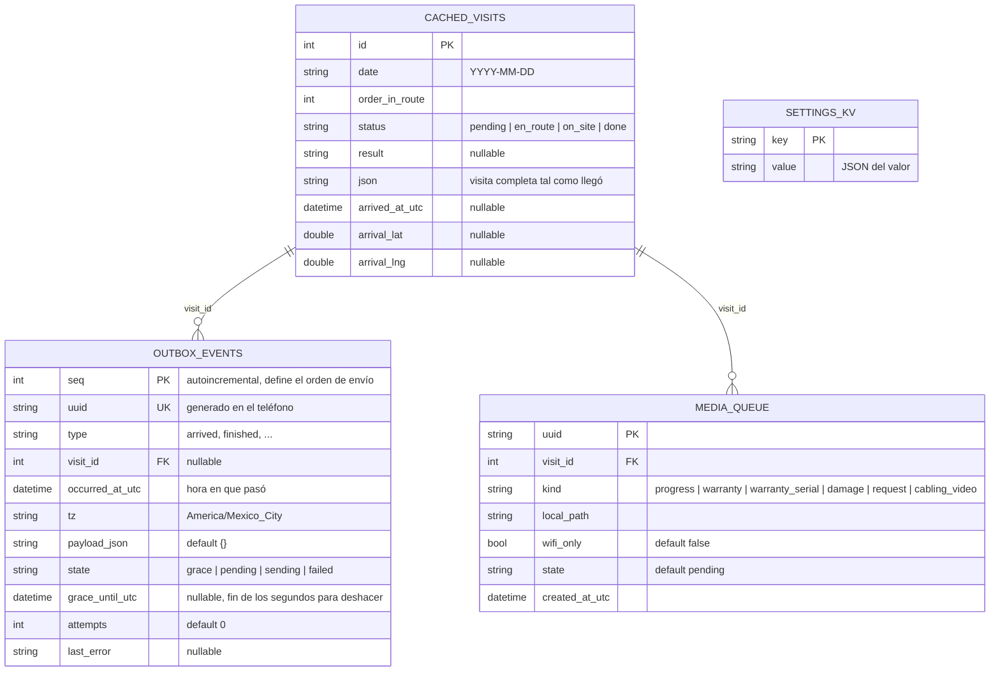
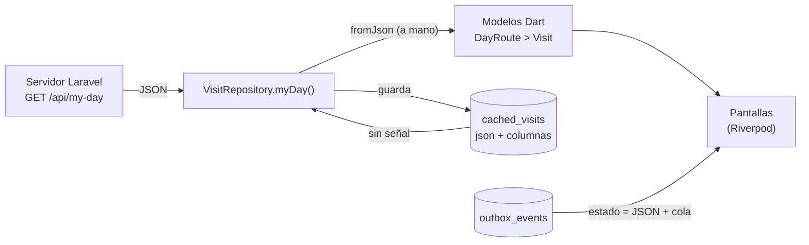
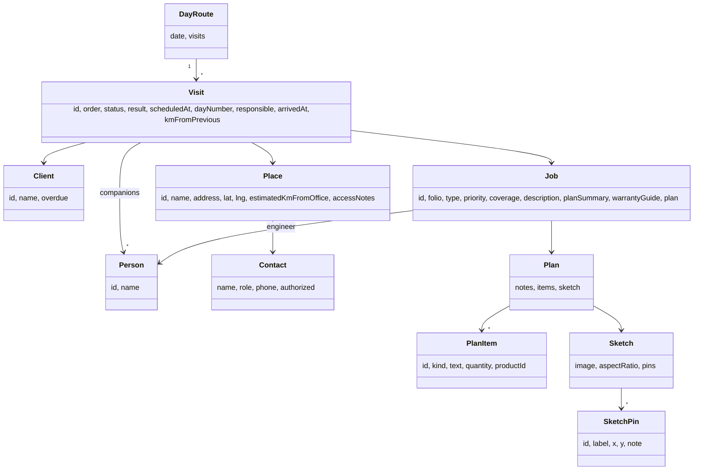
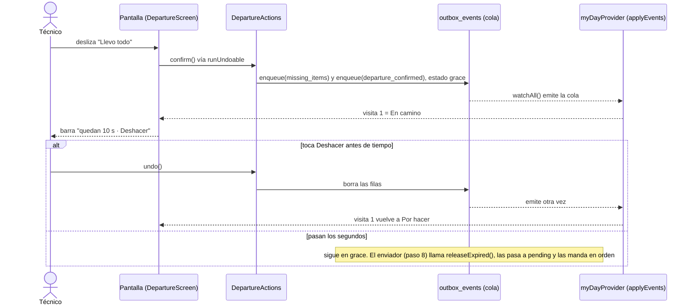
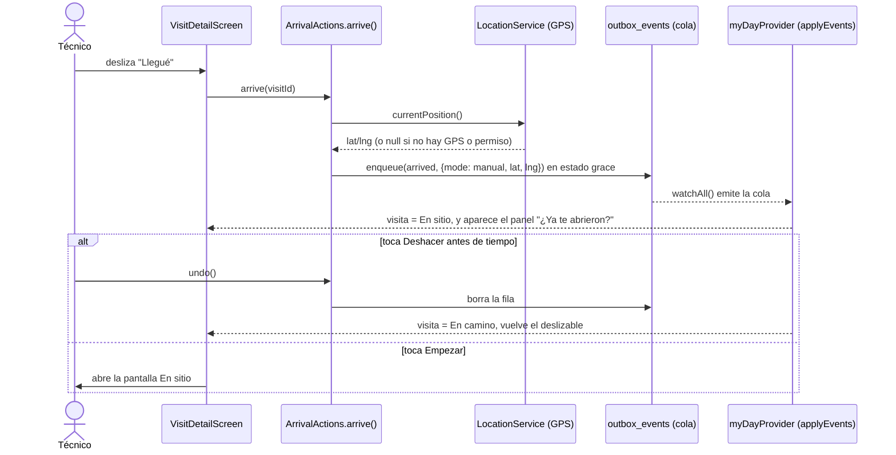
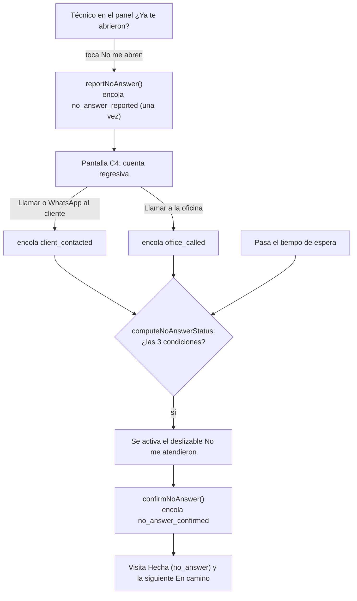
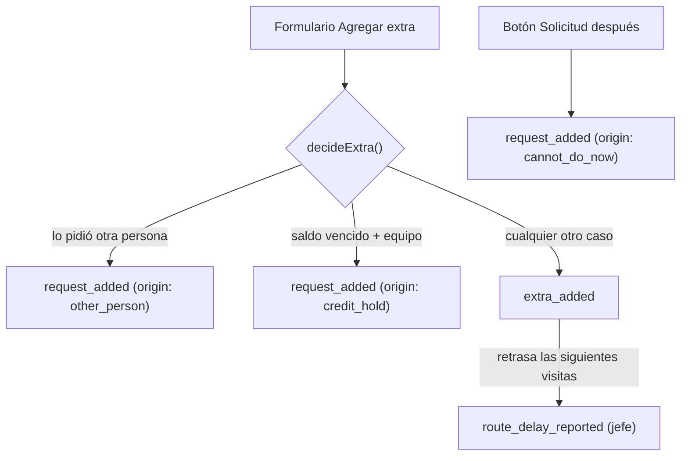
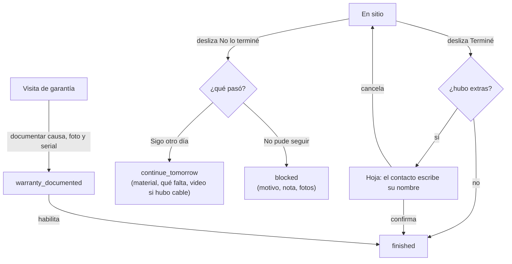
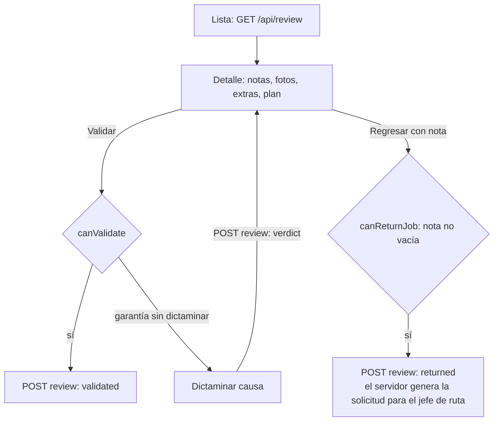

# Telyser · App de campo (Flutter)

App Android para técnicos e ingenieros de campo de Telyser (cámaras, alarmas, redes). Funciona completa con datos de prueba; la API real (Laravel) está pendiente.

**Qué hace hoy:** login y cambio de contraseña, Mi día con mapa y ruta por el vecino más cercano, salida con lista de material, llegada, "No me abren", En sitio (fotos, extras, garantía), cierre (Terminé, Sigo otro día, No pude seguir), resumen de la visita cerrada, plan del trabajo con croquis, Mis trabajos (estado de lo que terminó), Avisos, Por validar del ingeniero y Rutas del jefe de ruta. Todo lo del técnico funciona sin señal y se manda en una cola.

## Índice
1. [Cómo arrancar](#cómo-arrancar)
2. [Modo demo](#modo-demo)
3. [Arquitectura](#arquitectura)
4. [Base de datos local](#base-de-datos-local-drift--sqlite)
5. [Cómo se mapea `GET /api/my-day`](#cómo-se-mapea-get-apimy-day)
6. [Cómo funciona una acción del técnico](#cómo-funciona-una-acción-del-técnico)
7. [Módulos](#módulos)
8. [Cómo agregar cosas](#cómo-agregar-cosas)
9. [Pruebas](#pruebas)
10. [Pendiente](#pendiente)

## Cómo arrancar
1. `flutter pub get`
2. `flutter test` (incluye que los archivos de `assets/mock/` cumplen el contrato)
3. `flutter run`

Después de cambiar una tabla de Drift: `dart run build_runner build --delete-conflicting-outputs`.

Usuarios de prueba:
- `pedro` / `pedro123`: técnico. Pestañas Mi día, Mis trabajos y Avisos.
- `tono` / `tono123`: técnico + ingeniero + coordina rutas. Pestañas Mi día, Mis trabajos, Rutas, Por validar y Avisos.

El contrato con el servidor está en `docs/contrato_api.md`.

## Modo demo

Con `kDemoMode = true`:
- La espera de "No me abren" es de 1 minuto (`wait_base_min: 1`, `wait_per_km_min: 0`).
- El repositorio de prueba pone la fecha de hoy a la ruta.
- El menú ⋮ de Mi día ofrece **Cambiar contraseña**, **Cerrar sesión**, **Reiniciar datos de demo** (borra la cola y las fotos) y **Simular sesión expirada**. Una contraseña cambiada vive en memoria: al cerrar la app por completo vuelve la original.

"Reiniciar datos de demo" **no** restaura la lista de Por validar: esa vive en memoria del repositorio de prueba y vuelve a su estado inicial al cerrar la app por completo.

## Arquitectura

No es MVC clásico. Es una arquitectura por capas con estado reactivo (parecida a MVVM con Clean Architecture). Regla: las dependencias solo van hacia adentro. `test/architecture_test.dart` la vigila con 5 reglas.

```
features/     pantallas  ──►  providers/  ──►  application/  ──►  domain/
                                  │                 │
                                  └──────►  data/ ◄─┘   (data implementa contratos)
core/         widgets y utilidades genéricas, sin reglas del negocio
```

| Carpeta | Qué contiene | Qué NO puede importar |
|---|---|---|
| `domain/` | Modelos, eventos y reglas en Dart puro | Flutter, Drift, `dart:io`, ni ninguna otra capa |
| `application/` | Qué pasa cuando alguien hace algo (una clase por área) | Flutter, pantallas, providers |
| `data/` | Drift, repositorios (de prueba hoy, API mañana), ubicación | Pantallas |
| `providers/` | Conecta todo con Riverpod, un archivo por tema | — |
| `features/` | Pantallas y sus widgets | — |
| `core/` | Widgets compartidos, formato, tema, lanzadores | Reglas del negocio |

### Ideas que sostienen el diseño

- **El estado de una visita se calcula, no se guarda:** `ruta del servidor + eventos de la cola`. Por eso deshacer es borrar una fila y por eso el estado sobrevive a cerrar la app (es un event sourcing ligero).
- **Las pantallas nunca cambian el estado directamente.** Solo encolan eventos.
- **Flujo en un solo sentido:** pantallas → providers → application → domain. `data` implementa los contratos que define el dominio.
- **Cada evento lleva un UUID** generado en el teléfono, para que reintentar el envío no duplique nada.
- **Nada configurable va fijo en el código:** los parámetros (segundos para deshacer, radio de llegada, espera, etc.) vienen del servidor (`/api/settings`) y se guardan localmente.
- **Lectura tolerante:** un tipo de evento que la app no conoce se lee como `UnknownEvent` y no la rompe.
- **Lo que necesita señal no pasa por la cola.** Validar, regresar y dictaminar (ingeniero) van directo al servidor.

### Convenciones de pantalla

| Necesito... | Uso |
|---|---|
| Guardar una acción con "Deshacer" | `runUndoable(context, ref, action: (a) => a.<área>.<método>(...), message: ..., after: AfterSave.pop)` (`AfterSave.stay`, `pop` o `popToRoot`) |
| Un aviso corto | `messenger.toast('...')` (con el `messenger` guardado antes del `await`) |
| Una caja blanca con borde | `AppCard(child: ...)` |
| Mostrar un número (cantidad, km) | `formatNumber(valor)` |
| Un campo donde se escribe un número o texto corto | `inputFormatters: decimalInput` (cantidades), `integerInput` (minutos, piezas) o `shortText(max)`. `keyboardType` solo cambia el teclado: no impide pegar letras |
| Abrir mapa, llamar o WhatsApp | `openMap(...)`, `callPhone(...)`, `openWhatsApp(...)` |
| Mostrar una imagen de asset o URL | `AppImage(src: ...)` |
| Mostrar las fotos o videos tomados por el técnico, con ver y borrar | `MediaStrip(items: ...)` (en `features/media/`) |
| Un formulario con algo escrito que no se debe perder | `UnsavedGuard(dirty: …)` y la flecha con `maybePop()` (ver "Salir sin guardar") |
| Una pantalla larga | Una pantalla que solo **compone** secciones en `widgets/`; cada sección lee lo que necesita con `ref.watch` |

## Base de datos local (Drift / SQLite)

Archivo `telyser.sqlite` dentro del teléfono. Definida en `lib/data/local/app_database.dart`.



| Tabla | Para qué sirve |
|---|---|
| `settings_kv` | Parámetros de `/api/settings`. Sin señal se leen de aquí |
| `cached_visits` | Ruta del día descargada, para verla sin señal |
| `outbox_events` | Cola de acciones por enviar, en orden (`seq`) y con `uuid` para evitar duplicados |
| `media_queue` | Fotos y videos pendientes de subir |

**Estados de `outbox_events.state`:** `grace` (segundos para deshacer, no enviable) → `pending` → `sending` → `failed` (se reintenta). Deshacer borra la fila.

**Notas:**
- Las relaciones por `visit_id` son lógicas. Drift no declara llaves foráneas reales en este esquema, así que la base no impide guardar un `visit_id` que no exista en `cached_visits`.
- `settings_kv` no se relaciona con las demás tablas.
- `media_queue` y `outbox_events` no se relacionan entre sí: las fotos y videos se suben por su propio camino (`POST /api/visits/{id}/media`).
- Las fotos se copian a `<documentos de la app>/media/visit_<id>/<uuid>.jpg`. La carpeta de la cámara es temporal y Android puede borrarla, por eso se copia.

## Cómo se mapea `GET /api/my-day`

Contrato completo en `docs/contrato_api.md`. Ejemplo real en `assets/mock/my_day.json`.

### Flujo



Hoy el repositorio de prueba lee el JSON de `assets/mock/` en lugar del servidor. Lo demás (guardar la ruta, leerla sin señal y combinarla con la cola) ya funciona.

### Estructura del JSON y su modelo Dart



Los modelos se parsean a mano con `fromJson`, con lectores tolerantes (`readString`, `readInt`, `readMaps`…): un campo faltante o de tipo raro no tumba la app.

### Campo por campo

| JSON | Modelo Dart | Notas |
|---|---|---|
| `date` | `DayRoute.date` | |
| `visits[]` | `DayRoute.visits` | Se ordena por `order` al parsear |
| `visits[].status` | `Visit.status` (`VisitStatus`) | `pending`, `en_route`, `on_site`, `done`. Un valor desconocido cae en `pending` |
| `visits[].result` | `Visit.result` (`VisitResult?`) | `finished`, `continue`, `blocked`, `no_answer`. Nulo si no está `done` |
| `scheduled_at`, `arrived_at` | `scheduledAt`, `arrivedAt` | Se convierten a UTC. Se muestran en America/Mexico_City con `formatClock` |
| `day_number` | `dayNumber` | "Día N" sin total |
| `responsible` | `responsible` | `false` = acompañante |
| `companions[]` | `List<Person>` | |
| `km_from_previous` | `kmFromPrevious` | Alimenta la espera de "No me abren" |
| `visits[].order` | `Visit.order` | Ya no define el orden de la ruta: la app lo calcula. Solo sirve de respaldo |
| `client.tier` | `Client.tier` (`ClientTier?`) | `A`, `B` o `C`; nulo si no viene |
| `client` | `Client` | `overdue` es solo sí/no, nunca montos |
| `place` | `Place` | `lat`, `lng` y `estimated_km_from_office` pueden ser nulos |
| `place.contact` | `Contact?` | `authorized` = puede pedir extras |
| `job.type` | `Job.type` (`JobType`) | `installation`, `corrective`, `preventive` |
| `job.priority` | `Job.priority` (`Priority`) | `normal`, `urgent` |
| `job.coverage` | `Job.coverage` (`Coverage`) | `paid`, `warranty`, `policy` |
| `job.engineer` | `Job.engineer` (`Person?`) | Para abrir WhatsApp con el ingeniero a cargo |
| `job.plan_summary`, `warranty_guide` | `planSummary`, `warrantyGuide` | Texto o nulo |
| `job.plan` | `Job.plan` (`Plan?`) | Notas, material, herramienta y croquis con pines. Nulo si todavía no hay |

### Qué se ignora todavía

Estos campos del contrato **no** se leen en el modelo actual:

| Campo | Se necesitará en |
|---|---|
| `generated_at`, `technician` (raíz) | Informativos |
| `visits[].left_at` | Visita hecha (C8) |
| `job.status`, `job.close_mode`, `job.block` | Vista del jefe de ruta (paso 6) |

El JSON completo de cada visita se guarda en `cached_visits.json`, así que agregar un campo después **no requiere migrar la base**: solo se amplía el modelo Dart.

### Cuando cambie el contrato

1. Actualizar `docs/contrato_api.md` y el archivo de `assets/mock/` que corresponda.
2. Ajustar el modelo en `lib/domain/`.
3. Correr `flutter test`. Las pruebas de modelos verifican que los mocks cumplen el contrato.

## Cómo funciona una acción del técnico

Ejemplo: Salida.



**Regla de oro:** las pantallas nunca cambian el estado de una visita directamente. Solo encolan eventos; el estado se **recalcula** como `ruta del servidor + eventos de la cola`.

La barra de deshacer calcula el tiempo restante desde una hora límite fija guardada con el evento (nunca desde un contador propio), así no se reinicia ni muestra el mensaje anterior.

### Reglas de `applyEvents`

`applyEvents` es una función pura con un `switch` sobre los eventos tipados, **sin `default`**: si agregas un evento nuevo, el compilador te obliga a decidir qué hace.

| Evento | Efecto en la ruta |
|---|---|
| `departure_confirmed` | La visita pasa de Por hacer a En camino |
| `arrived` | La visita pasa a En sitio y guarda la hora |
| `finished`, `continue_tomorrow`, `blocked`, `no_answer_confirmed` | La visita queda cerrada con su resultado (Hecha, Sin terminar, Detenida o Sin atender). La siguiente **no** arranca sola: el técnico elige a cuál va con `departure_confirmed` |
| Los demás (incluida `note_added`) | No cambian el estado; solo viajan al servidor |

### Cuándo se puede marcar "Llegué"

`arrivalBlock(visit, visits)` decide si el deslizable está activo:

| Resultado | Cuándo | Qué ve el técnico |
|---|---|---|
| `routeNotStarted` | La visita todavía está Por hacer (no ha salido a ella) | Deslizable gris con el motivo |
| `anotherVisitInProgress` | Hay otra visita En camino o En sitio | Deslizable gris con el motivo |
| (ninguno) | La visita está En camino y no hay otra en curso | Deslizable activo |

## Módulos

### Salida y lista de material (C2)
`features/departure/` muestra la lista (sale de `job.plan.items`), los faltantes y el deslizable "Llevo todo". Acciones en `application/` (área `departure`).

### Llegada y "¿Ya te abrieron?"



| Archivo | Qué hace |
|---|---|
| `data/location_service.dart` | `LocationService` (contrato) y `DeviceLocationService` (GPS real). Lee la ubicación una sola vez. Si falla, devuelve `null` y Llegué se marca igual |
| `features/my_day/visit_detail_loader.dart` | Lee la visita actual y se la pasa a la tarjeta para que se redibuje sola |
| `features/my_day/arrival_panel.dart` | Panel "¿Ya te abrieron?" con Empezar y No me abren |

### "No me abren"



La espera es `wait_base_min + wait_per_km_min × km`, redondeada hacia arriba al minuto. Siempre se calcula desde la hora de llegada guardada; el reloj de la pantalla (`tickProvider`, cada segundo) solo la redibuja.

| Parámetro del servidor | Para qué |
|---|---|
| `wait_base_min`, `wait_per_km_min` | Cuánto espera el técnico |
| `min_client_contacts`, `min_office_calls` | Intentos mínimos antes de poder irse |
| `office_phone` | Teléfono del botón "Llamar a la oficina" |

### En sitio y fotos (C5)

`features/site/site_screen.dart` solo **compone** secciones de `features/site/widgets/`: `NoAnswerBanner`, `ArrivalInfo`, `WarrantySection`, `PhotosSection`, `ExtrasSection` y `CloseBar`.

| Regla | Dónde |
|---|---|
| Solo el responsable cierra la visita | `visit.responsible` en `SiteScreen`; los acompañantes no ven los botones de cierre |
| En garantía no se puede terminar sin el bloque de garantía | `isWarranty` deshabilita el deslizable |
| Las visitas En sitio abren directo C5 desde Mi día | `my_day_screen.dart` |

Las fotos y videos se guardan con `MediaRepository` (`addPhoto`, `addVideo`, `watchForVisit`, `clearAll`). Devuelve `MediaItem` con un `MediaKind`, para que las pantallas no conozcan Drift. `features/site/capture_photo.dart` abre la cámara.

#### Ver y borrar fotos y videos

Las fotos y videos que el técnico toma se ven como miniaturas en una tira (`MediaStrip`): en En sitio (fotos de avance), en Garantía (falla y etiqueta), en No pude seguir (daño), en Solicitud para después (las de esa solicitud) y en Sigo otro día (video del cableado). Tocar una miniatura abre el visor a pantalla completa: se desliza entre archivos, las fotos se acercan con dos dedos y el video se reproduce (toca para pausar). La X de la esquina o el botón "Borrar" del visor la quitan, previa confirmación.

| Regla | Dónde |
|---|---|
| Solo se borra lo que todavía no se subió (reloj ámbar). Lo ya enviado (nube verde) no tiene X ni botón, porque no hay ruta en el servidor para quitarlo | `canDeleteMedia` en `domain/media_rules.dart` y `MediaActions.delete` |
| Borrar quita la fila de `media_queue` y el archivo. Si el archivo ya no existe, igual quita la fila | `MediaRepository.delete` |

| Archivo | Qué hace |
|---|---|
| `features/media/media_strip.dart` | La tira de miniaturas con su X |
| `features/media/media_viewer_screen.dart` | El visor de fotos y videos (usa `video_player`) |
| `features/media/confirm_delete.dart` | La pregunta "¿Borrar esta foto?" |
| `application/media_actions.dart` | `MediaActions.delete`, expuesta como `mediaActionsProvider` |

`capturePhoto` y `captureVideo` devuelven el id del archivo (o null si el técnico canceló).

### Extras y solicitudes para después



`decideExtra` es la regla (pura, en `domain/`). `isEquipment` del producto alimenta la regla del saldo vencido. Pantallas: `features/extras/add_extra_screen.dart` (E1) y `add_request_screen.dart` (E4, con fotos). Solo existen dos unidades: pieza y servicio.

### Cierre de la visita



| Archivo | Qué hace |
|---|---|
| `features/site/warranty_*.dart` | Tarjeta y pantalla del bloque de garantía (G1 y G1b) |
| `features/closing/finish_sheet.dart` | C6: confirmación de extras |
| `features/closing/not_finished_sheet.dart` | C7: elegir entre las dos opciones |
| `features/closing/continue_screen.dart` | C7a: Sigo otro día |
| `features/closing/blocked_screen.dart` | C7b: No pude seguir (6 motivos, nota obligatoria, casos especiales de accidente y daño) |
| `core/widgets/choice_group.dart` | Grupo de chips compartido |

Reglas en `domain/`: `canSaveWarranty`, `canContinueTomorrow`, `canSendBlocked`.

### Plan del trabajo (D1)

El técnico ve el plan del ingeniero en solo lectura (el ingeniero también lo puede editar, ver abajo): notas, material, herramienta y un croquis con pines.

| Archivo | Qué hace |
|---|---|
| `features/plan/plan_screen.dart` | Pantalla D1 |
| `features/plan/widgets/sketch_view.dart` | El croquis con pines interactivos. Los pines usan `x` y `y` relativos (0 a 1), así no dependen del tamaño de pantalla |
| `core/widgets/app_image.dart` | Imagen de asset (pruebas) o de URL (API real). Si no carga, muestra un ícono |
| `assets/mock/croquis_hotel.png` | Croquis de ejemplo (Hotel Bahía) |

Se llega desde "Ver plan completo" en la tarjeta de la visita y desde "Ver plan del ingeniero" en En sitio.

#### Editar el plan (ingeniero)

Con el permiso `engineer`, la pantalla del plan muestra **Editar** (y la tarjeta de la visita ofrece **Crear plan** si el trabajo no tiene). El ingeniero cambia las notas, agrega, edita o quita material y herramienta, y en el croquis agrega puntos (tocando un lugar vacío), los mueve (arrastrando) y edita su etiqueta y nota. Guardar necesita señal y **no pasa por la cola**. La imagen del croquis no se cambia desde la app: se sube desde la web.

| Archivo | Qué hace |
|---|---|
| `features/plan/plan_edit_screen.dart` | Pantalla D2. Los cambios viven solo en la pantalla hasta tocar "Guardar plan" |
| `features/plan/widgets/sketch_editor.dart` | El croquis editable (agregar, elegir y arrastrar pines) |
| `domain/plan_rules.dart` | `canSavePlan` (sin renglones ni pines vacíos, cantidades positivas) y `nextLocalId` |
| `data/repositories.dart` | Interfaz `PlanRepository` |
| `data/mock/mock_repositories.dart` | `MockPlanRepository`: guarda en memoria en un `MockPlanStore`, que `MockVisitRepository` aplica a la ruta. Al cerrar la app por completo vuelve el plan original |
| `application/plan_actions.dart` | `PlanActions.save`. Después de guardar, la ruta se vuelve a pedir |
| `providers/plan_providers.dart` | `planActionsProvider` y `jobPlanProvider(jobId)` (el plan vigente) |

### Por validar (ingeniero)

El ingeniero revisa los trabajos terminados por otros técnicos y los valida, los regresa con nota o dictamina la causa de una garantía.



**No pasa por la cola:** necesita señal, así que va directo al repositorio. Por eso no hay eventos nuevos ni casos nuevos en `applyEvents`.

| Archivo | Qué hace |
|---|---|
| `domain/models/review_models.dart` | `ReviewJob`, `ReviewPhoto`, `ReviewExtra`, `ReviewWarranty` |
| `domain/review_rules.dart` | `canValidate` (sin dictamen pendiente) y `canReturnJob` (nota obligatoria) |
| `data/repositories.dart` | Interfaz `ReviewRepository` |
| `data/mock/mock_repositories.dart` | `MockReviewRepository`: lee `assets/mock/review.json` y guarda los cambios en memoria |
| `application/review_actions.dart` | `validate`, `returnJob`, `submitVerdict`. Tras cada una, la lista se vuelve a pedir |
| `providers/review_providers.dart` | `reviewListProvider`, `reviewJobProvider(id)`, `reviewActionsProvider` |
| `features/review/` | Lista (F1), detalle (F2), nota al regresar (F2b), dictamen (F3) y `widgets/photo_strip.dart` |

### Mis trabajos (técnico)

El técnico ve los trabajos que ya terminó y qué decidió el ingeniero: **Por validar**, **Validado** o **Regresado**. En los regresados, la nota del ingeniero va en un recuadro rojo destacado. Es solo lectura y no pasa por la cola.

| Archivo | Qué hace |
|---|---|
| `domain/models/my_job_models.dart` | `MyJob`, `MyJobStatus` (un valor desconocido cae en Por validar) y `sortMyJobs` (regresados, por validar, validados; lo más reciente primero) |
| `data/repositories.dart` | Interfaz `MyJobsRepository` |
| `data/mock/mock_repositories.dart` | `MockMyJobsRepository`: lee `assets/mock/my_jobs.json` |
| `providers/my_jobs_providers.dart` | `myJobsProvider` (ya ordenado; se vuelve a pedir al cambiar de sesión o al jalar para actualizar) |
| `features/my_jobs/my_jobs_screen.dart` | Lista con etiqueta de estado y la nota destacada |

Los datos de prueba no cambian cuando el ingeniero valida o regresa en Por validar: son listas independientes hasta que exista la API.

### Sesión expirada

Cuando el servidor responde 401, el cliente HTTP llama `ref.read(sessionProvider.notifier).expire()`. La app vuelve al login con un aviso ("Tu sesión expiró") y **no borra la cola local**. Al volver a entrar solo se acepta la misma cuenta: si entra otra persona, `login` lanza `WrongAccountException` y se cierra esa sesión, porque las acciones sin enviar son de la anterior. Salir con "Cerrar sesión" no cuenta como expirar.

| Archivo | Qué hace |
|---|---|
| `domain/session_errors.dart` | `SessionExpiredException` y `WrongAccountException` |
| `providers/session_provider.dart` | `SessionNotifier.expire()` y `expiredUserProvider` (quién tenía la sesión) |
| `features/auth/login_screen.dart` | Muestra el aviso cuando `expiredUserProvider` no es nulo |

Todavía no hay cliente HTTP (paso 8), así que nada llama `expire()` por sí solo. En la demo, el menú ⋮ de Mi día tiene **Simular sesión expirada**.

### Permiso de ubicación

La ubicación solo sirve para guardar las coordenadas al marcar "Llegué"; esa acción funciona igual sin ella. En Mi día, `LocationBanner` explica para qué se usa y pide el permiso. Tiene tres casos: pedir el permiso, abrir los ajustes si lo negó para siempre y abrir los del GPS si está apagado. Se vuelve a revisar solo cuando la app regresa de los ajustes. Desaparece cuando todo está en orden.

| Archivo | Qué hace |
|---|---|
| `domain/models/location_access.dart` | `LocationAccess`: concedido, negado, negado para siempre, GPS apagado |
| `data/location_service.dart` | `access()`, `request()` y `openSettings()` además de `currentPosition()` |
| `providers/location_providers.dart` | `locationAccessProvider` |
| `features/my_day/widgets/location_banner.dart` | El aviso |

### Avisos

Lista de lo que el servidor le dice al usuario: cambios de ruta, trabajos regresados o validados, planes nuevos. Los no leídos llevan el título en negritas y un punto rojo, y la pestaña muestra un punto si hay alguno. Tocar un aviso lo marca como leído; "Marcar todo" marca todos. No pasa por la cola. Un tipo de aviso que la app no conoce se muestra igual, con un ícono genérico. Las notificaciones push (paso 7) usarán esta misma lista.

| Archivo | Qué hace |
|---|---|
| `domain/models/notification_models.dart` | `AppNotification`, `NoticeType` (un tipo desconocido cae en `other`), `unreadCount` y `sortNotifications` |
| `data/repositories.dart` | Interfaz `NotificationsRepository` |
| `data/mock/mock_repositories.dart` | `MockNotificationsRepository`: lee `assets/mock/notifications.json` y recuerda en memoria qué se leyó |
| `providers/notifications_providers.dart` | `notificationsProvider`, `unreadNoticesProvider` y `markNoticesReadProvider` |
| `features/notifications/notifications_screen.dart` | La pantalla |

### Ruta del día y mapa

El orden de la ruta **ya no viene del servidor** (`order` solo sirve de respaldo si falta una ubicación): lo calcula la app. Empieza en la oficina (parámetros `office_lat` y `office_lng`) con la visita más cercana, y de ahí va a la más cercana a esa (vecino más cercano). El técnico ve la ruta en un mapa grande (OpenStreetMap, necesita internet para los mosaicos; sin señal el mapa queda en blanco pero los puntos siguen ahí) con cada visita numerada: la siguiente parada va rellena en rojo y las demás en blanco con borde rojo. Abajo, la tarjeta **Siguiente parada** con cliente, dirección, distancia desde el punto anterior, tipo de cliente (A, B o C), la cita acordada y dos botones: **Iniciar navegación** (abre Maps o Waze) y **Detalle de visita**. Los números de la tarjeta (o los pines) cambian la parada que se mira.

- **Elegir con cuál empezar:** al mirar otra parada, el botón principal pasa a **Empezar por esta**. La ruta se rehace desde esa, con las demás por cercanía. "Volver a la ruta sugerida" deshace la elección.
- **Por calles:** la línea del mapa sigue las calles y los km de cada tramo son por calles, no en línea recta. La app se los pide a un servidor de rutas compatible con OSRM (`routing_base_url` en los parámetros del servidor). Mientras llega, sin señal o si la empresa no configuró uno, dibuja la línea recta punteada y usa la distancia recta. El **orden** de la ruta siempre se calcula con la distancia recta: es solo para comparar qué queda más cerca y no necesita internet. El servidor público de demostración de OSRM no es para producción: conviene uno propio.
- **La visita en curso también se puede mirar:** si ya vas en camino o estás en sitio, el mapa la muestra en verde y su tarjeta dice EN CAMINO o EN SITIO (en camino conserva Iniciar navegación; en sitio solo el detalle). Así, con la última visita en curso el mapa no dice que ya cerraste todo.
- **Las cerradas no cuentan:** la ruta se calcula solo con las visitas por hacer, y sale desde donde cerró la última (o desde la visita en curso).
- **La siguiente ya no arranca sola:** al cerrar una visita, el técnico queda Libre y Mi día muestra "Sigue X" con **Ir a X** y **Cambiar** (abre el mapa). Por la mañana la barra dice "Empiezas en X" y abre la Salida con la lista de material. Salir a una visita encola `departure_confirmed` de esa visita.
- **La elección vive solo mientras decide** (`routeStartProvider`): al salir, el estado queda guardado en la cola.

| Archivo | Qué hace |
|---|---|
| `domain/rules/route_planner.dart` | `distanceKm`, `nearestNeighborOrder` y `planRoute` (`RoutePlan`: activa, por hacer en orden, cerradas, km por tramo, y cuál sugiere el algoritmo) |
| `domain/models/geo_point.dart` | `GeoPoint` (antes vivía en `data/`, que el dominio no puede importar) |
| `data/osrm_routing_repository.dart` | `OsrmRoutingRepository` y `parseOsrmRoute`: piden y leen la ruta por calles (`RoutingRepository` es la interfaz) |
| `providers/routing_providers.dart` | `routingRepositoryProvider` y `routePathProvider` (solo vuelve a pedir si cambian los puntos, `RouteStops`) |
| `providers/route_providers.dart` | `appliedRouteProvider` (servidor + cola), `routeStartProvider`, `routePlanProvider` y `myDayProvider` (ya en el orden de la ruta) |
| `features/route/route_map_screen.dart` | La pantalla, con `widgets/route_map.dart` (el mapa y los pines), `stop_panel.dart` (la tarjeta de abajo) y `tier_chip.dart` |
| `features/my_day/open_visit.dart` | `openVisit`: abre el resumen, el trabajo o la tarjeta según el estado de la visita (lo usan Mi día y el mapa) |
| `features/my_day/widgets/next_stop_bar.dart` | La barra de abajo de Mi día: Salida o "Ir a la siguiente" |

### Visita cerrada: estado y resumen

Una visita cerrada solo es **Hecha** si se terminó. Si el técnico marcó "Sigo otro día" queda **Sin terminar · Día N**, "No pude seguir" queda **Detenida** y "No me atendieron" queda **Sin atender** (`visitStatusLabel` en `domain/visit_labels.dart`). Siguen cerradas para la ruta, pero ya no dicen que el trabajo está listo.

Al tocar una visita cerrada se abre su **resumen**, solo lectura: cómo se cerró (material usado, lo que falta, motivo, quién confirmó los extras), garantía, extras, solicitudes, y fotos y videos (sin poder borrarlos). Lo único que se puede hacer es **Agregar nota**, por si el técnico olvidó anotar algo; la nota viaja en la cola (`note_added`) y lo ya guardado no cambia.

| Archivo | Qué hace |
|---|---|
| `domain/rules/visit_summary.dart` | `summarizeVisit` arma el resumen con las acciones guardadas en el teléfono, y `canAddNote` |
| `features/visit_summary/` | La pantalla, `widgets/closing_card.dart` y `widgets/notes_section.dart` |

El resumen sale de las acciones guardadas **en el teléfono**. Cuando exista el envío de la cola (paso 8) y se limpie lo ya enviado, el resumen de visitas viejas tendrá que venir del servidor.

### Cuenta: contraseña

Dos caminos, los dos sin pasar por administración y los dos con las mismas reglas de contraseña nueva (`domain/password_rules.dart`: no vacía, al menos `password_min_length` caracteres y escrita igual las dos veces):

- **Con la sesión abierta**, menú ⋮ de Mi día → **Cambiar contraseña**: pide la actual y la nueva dos veces. Si la actual no es correcta, el servidor responde 422 y la pantalla lo dice.
- **Sin sesión**, **¿Olvidaste tu contraseña?** en el login: se escribe el usuario o teléfono, el servidor manda un código al teléfono registrado y se escribe el código con la contraseña nueva. Siempre responde igual, exista o no el usuario, para no revelar quién tiene cuenta. El largo del código y el mínimo de la contraseña los manda el servidor con la respuesta. Un código malo o vencido se avisa y se puede pedir otro. Al terminar vuelve al login con el usuario escrito. En la demo el código es `123456`.

Necesitan señal y no pasan por la cola.

| Archivo | Qué hace |
|---|---|
| `domain/password_rules.dart` | `checkNewPassword` (con sesión) y `checkResetPassword` (con código) |
| `domain/models/password_reset.dart` | `PasswordResetInfo`: largo del código y mínimo de la contraseña |
| `application/account_actions.dart` | `changePassword`, `requestReset` y `resetPassword` |
| `data/repositories.dart` | `AuthRepository.changePassword`, `requestPasswordReset` y `resetPassword` (el mock las guarda en memoria) |
| `features/account/change_password_screen.dart` | Cambiar con la sesión abierta |
| `features/auth/forgot_password_screen.dart` | Recuperar sin sesión, en dos pasos |

### Salir sin guardar

Todo formulario con algo escrito pregunta "¿Salir sin guardar?" antes de descartarlo: Editar plan, Agregar extra, Solicitud para después, Sigo otro día, No pude seguir, Garantía, Dictamen, Cambiar contraseña, y las hojas de nota, de cierre con extras y de regresar un trabajo. Se usa `UnsavedGuard(dirty: …)` de `core/widgets/unsaved_guard.dart`. Dos detalles:

- La flecha del encabezado debe llamar a `Navigator.of(context).maybePop()`, no a `pop()`: `pop()` se salta la pregunta. Las salidas del propio código al guardar sí usan `pop()`.
- Cada campo debe llamar a `setState` al cambiar, porque la guarda lee `dirty` en cada dibujo. En Solicitud para después, si se descarta, también se borran las fotos que se tomaron para ella.

### Rutas (jefe de ruta)

La pestaña **Rutas** (permiso `dispatch`) tiene cuatro secciones, como el documento de requisitos (sección 14): **Decisión** (urgencias arriba, detenidos, jornadas propuestas por "Sigo otro día", trabajos regresados, retrasos de ruta y llegadas fuera de orden), **Hoy** (cada técnico con su estado y sus visitas), **Por asignar** (trabajos sin visita con el semáforo de cinco luces: cliente confirmado, anticipo pagado, sin adeudo, material listo y acceso) y **Mañana**. Por ahora solo se mira: crear, mover y reordenar visitas es el paso 6b.

El servidor escribe el título y el detalle de cada decisión, y dice con `can_schedule` si un trabajo ya se puede programar (si no lo dice, solo lo bloquea una luz en rojo). El estado "En sitio en X" de cada técnico lo calcula la app con `technicianStateOf`, la misma regla de Mi día.

| Archivo | Qué hace |
|---|---|
| `domain/models/dispatch_models.dart` | `DispatchBoard`, `Decision` (`DecisionKind` tolerante), `TechnicianRoute`, `UnassignedJob`, `Light` y `LightState` |
| `data/repositories.dart` | Interfaz `DispatchRepository` |
| `data/mock/mock_repositories.dart` | `MockDispatchRepository`: lee `assets/mock/dispatch.json` |
| `providers/dispatch_providers.dart` | `dispatchProvider` |
| `features/dispatch/` | `dispatch_screen.dart` y `widgets/` (`decisions_section`, `routes_section`, `unassigned_section`) |

## Cómo agregar cosas

### Un evento nuevo del técnico

1. **Nombre:** una constante en `EventTypes` (`domain/events/event_types.dart`).
2. **Clase:** una clase `...Event` en `domain/events/event_data.dart`, con sus datos tipados, `toPayload()` y `fromPayload()`; y una línea en `EventData.parse`.
3. **Estado:** el compilador marcará el `switch` de `applyEvents` hasta que agregues el caso (aunque sea "no cambia el estado").
4. **Regla** (si hay decisiones): una función pura en `domain/`, con su prueba.
5. **Ejemplo:** agrégalo a la lista de `test/events_test.dart` (la prueba "hay un ejemplo por cada tipo" avisa si falta).
6. **Acción:** un método en la clase del área en `application/` (`departure`, `arrival`, `noAnswer`, `extras` o `closing`), con `PendingEvent(MiEvento(...), visitId: ...)`. Usa `_writer.undoable([...])` para acciones deslizables o con formulario, y `_writer.instant(...)` para botones normales.
7. **Pantalla:** `runUndoable(context, ref, action: (a) => a.<área>.<método>(...), message: '...', after: AfterSave.pop)`.
8. **Contrato:** documenta los datos en `docs/contrato_api.md`.

Lo que se guarda y viaja al servidor es siempre el mapa de `toPayload()`; la app nunca reescribe lo ya guardado.

### Una acción que necesita señal (no pasa por la cola)

Como las del ingeniero en Por validar:

1. Un método en la interfaz del repositorio (`data/repositories.dart`) y su versión de prueba.
2. La regla en `domain/`, y el método en una clase de `application/` que la aplique.
3. Un provider que avise cuando algo cambió para volver a pedir la lista.
4. La pantalla guarda `messenger` y `navigator` antes del `await`, bloquea el botón mientras envía y avisa si no hay conexión.
5. Documenta la ruta en el contrato.

### Una pantalla nueva

Una pantalla que solo **compone** secciones; cada sección lee lo que necesita con `ref.watch`. Usa `AppCard`, `toast`, `formatNumber` y `AppImage` en lugar de repetir código.

## Pruebas

`flutter test` corre, entre otras:

| Prueba | Qué vigila |
|---|---|
| `models_test` | Que los mocks cumplen el contrato |
| `outbox_test` | La cola: `enqueue`, `undo`, `releaseExpired`, `nextBatch` |
| `settings_store_test`, `route_store_test` | Guardado local de parámetros y de la ruta |
| `visit_state_test`, `events_test` | `applyEvents` y los eventos tipados (un ejemplo por tipo) |
| `no_answer_test`, `extras_test`, `closing_test`, `arrival_rules_test` | Las reglas puras de cada área |
| `visit_actions_test`, `media_repository_test`, `media_actions_test` | Las acciones, y guardar y borrar fotos y videos |
| `review_test` | Por validar: modelos, reglas y acciones |
| `my_jobs_test` | Mis trabajos: el mock, el estado desconocido y el orden |
| `plan_test` | Editar el plan: reglas, ida y vuelta del JSON y la acción de guardar |
| `format_test` | Formato de números |
| `input_formatters_test` | Los filtros de los campos descartan letras y signos, y respetan el largo |
| `session_test` | Sesión expirada: salir sin tocar la cola y exigir la misma cuenta |
| `notifications_test` | Avisos: el mock, tipos desconocidos, conteo, orden y la hora relativa |
| `routing_test` | La ruta por calles: lector de OSRM, cliente HTTP, tramos por calles y el provider |
| `stop_panel_test` | La tarjeta del mapa: la visita en curso (en camino o en sitio), la siguiente parada y cuando ya no queda nada |
| `route_planner_test`, `route_providers_test` | La ruta: distancia, vecino más cercano, elegir la primera, cerradas fuera y el cableado con la oficina y la cola |
| `visit_labels_test`, `visit_summary_test` | Hecha / Sin terminar / Detenida / Sin atender y el resumen de una visita con sus notas |
| `account_test` | Cambiar y recuperar la contraseña: reglas, acciones y repositorio de prueba |
| `unsaved_guard_test` | La pregunta de salir sin guardar |
| `dispatch_test` | Rutas: el mock, decisiones, estado del técnico y semáforo |
| `architecture_test` | Las 5 reglas de dependencias por capa |

## Pendiente

- **Paso 6b:** Jefe de ruta: crear, mover y reordenar visitas, y meter una urgencia en la ruta de alguien (hoy Rutas solo se mira).
- **Paso 7:** "Llegué" automático por geocerca y notificaciones push (Firebase). La lista de Avisos ya existe; falta que las push la alimenten.
- **Paso 8:** API real, envío de la cola, subida y compresión de fotos.
- **Por confirmar con la empresa:** `credit_authorization_wait_min` (¿5 o 15 minutos?).
