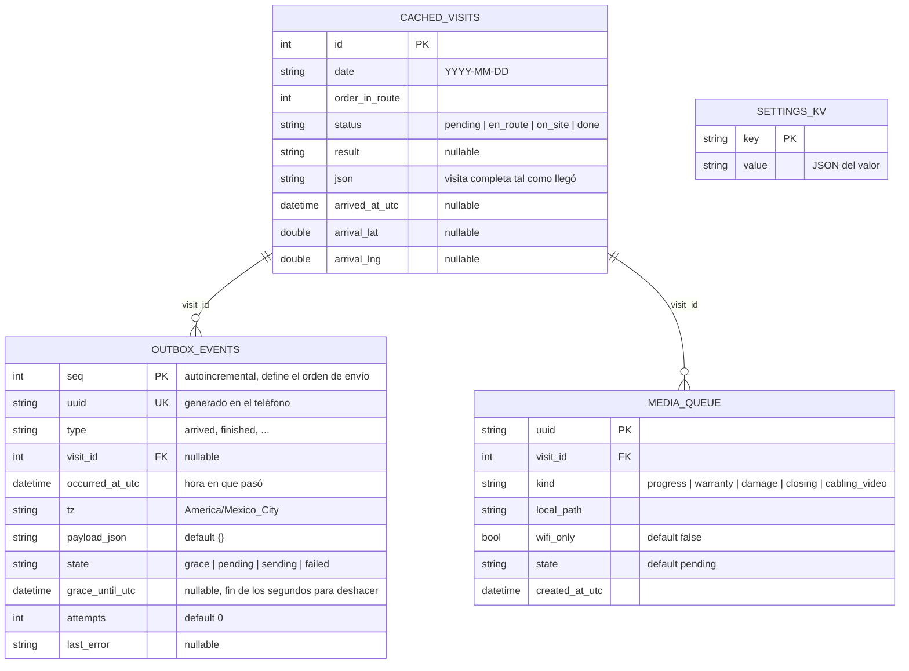
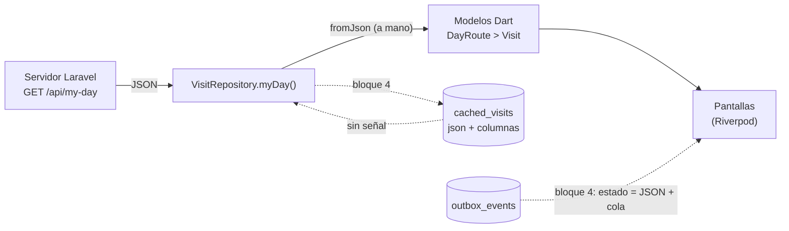
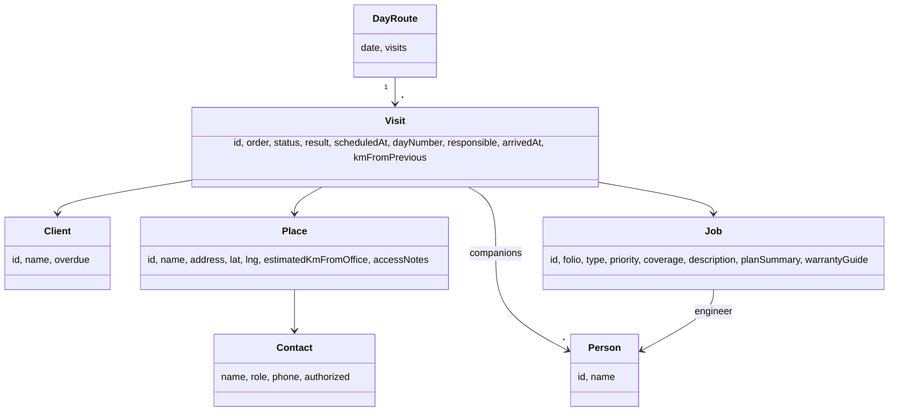
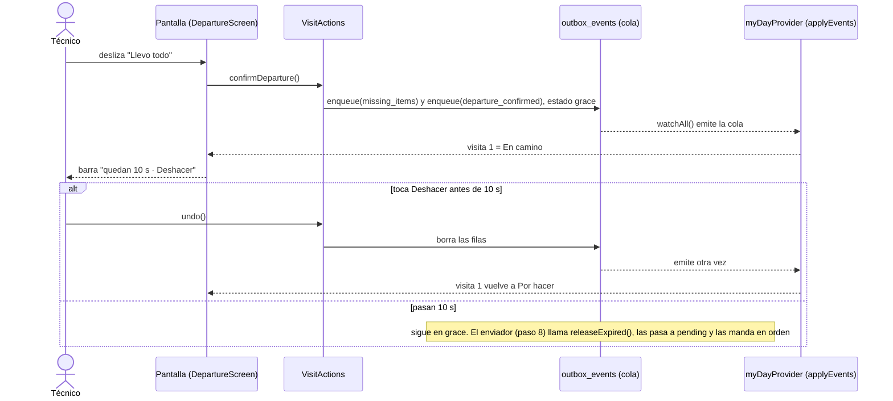
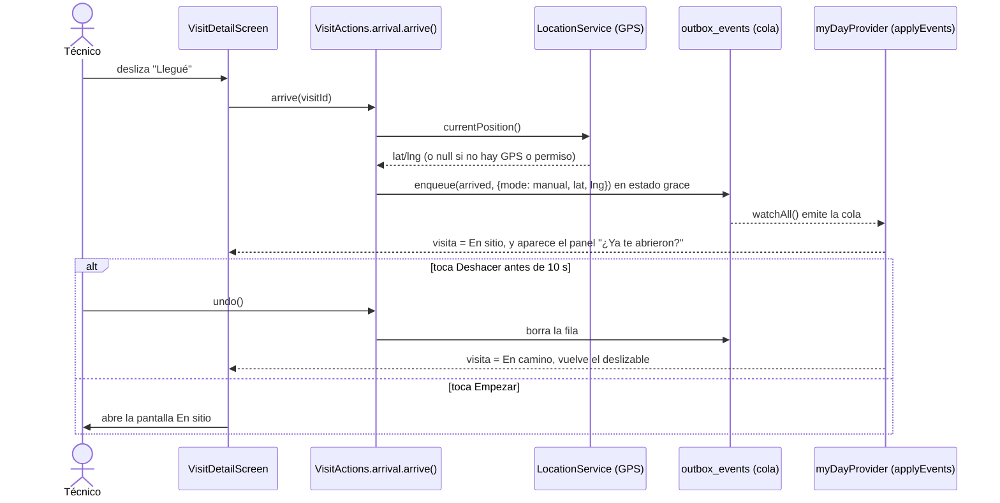
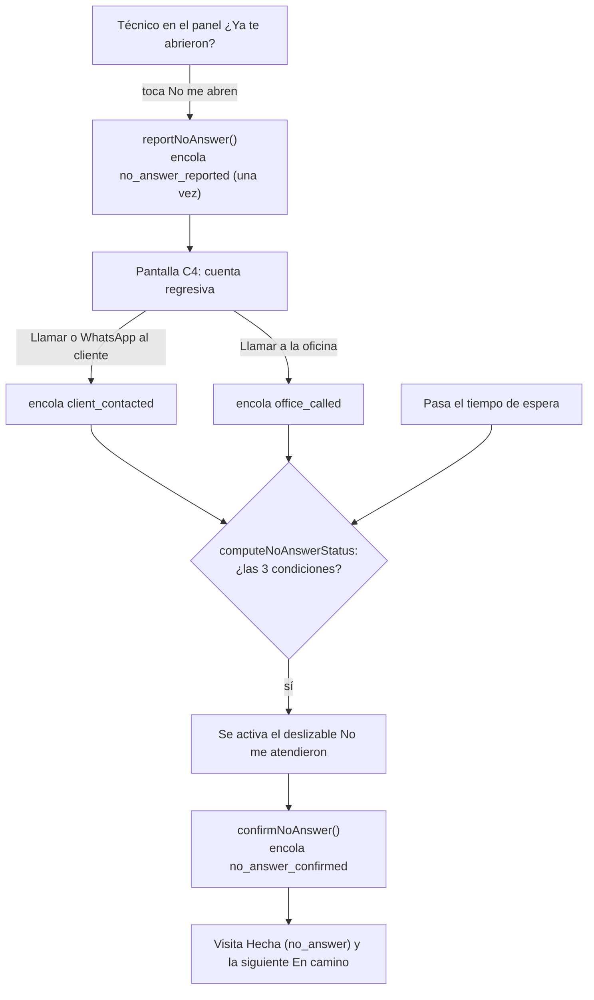
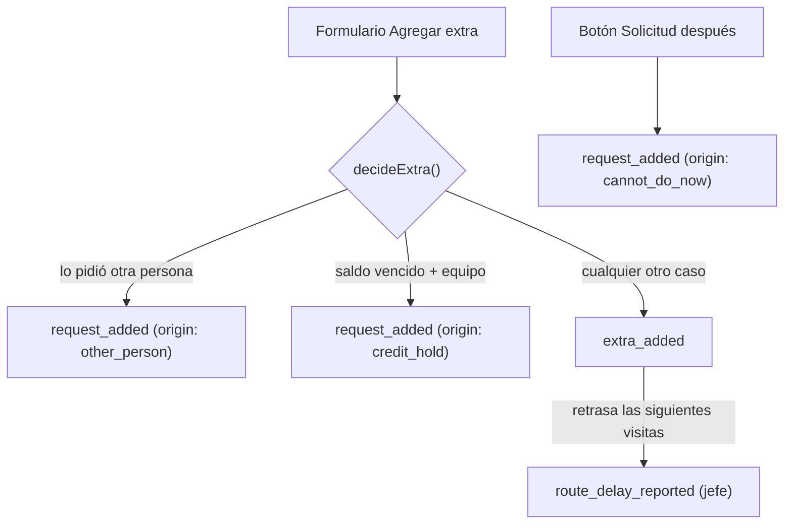
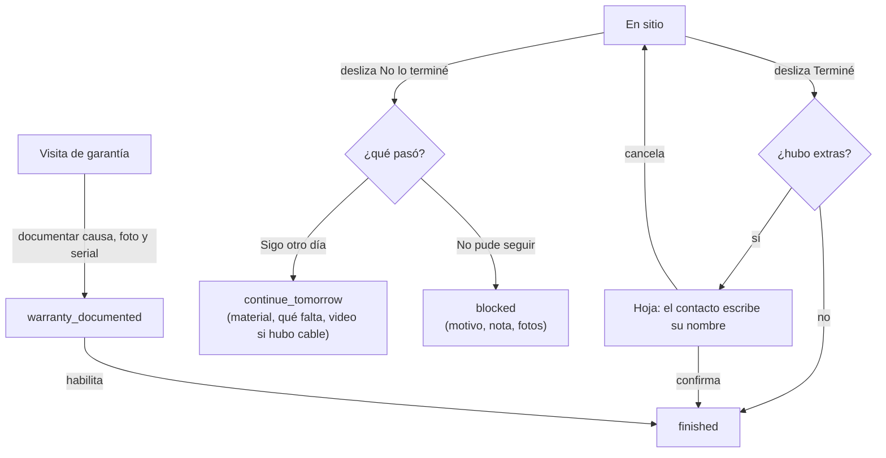

# Telyser · App de campo (Flutter)

**Login, Mi día y tarjeta de visita, con datos de prueba.**

## Cómo arrancar
1. `flutter pub get`
2. `flutter test` (prueba que `assets/mock/my_day.json` cumple el contrato y demas tests)
3. `flutter run`

Usuarios de prueba (cualquier contraseña):
- `pedro` (o cualquier otro): técnico. Pestañas Mi día y Avisos.
- `tono`: técnico + ingeniero + coordina rutas. Pestañas Mi día, Rutas, Por validar y Avisos.

## Arquitectura

Regla: las dependencias solo van hacia adentro. `test/architecture_test.dart` la vigila.

```
features/     pantallas  ──►  providers/  ──►  application/  ──►  domain/
                                  │                 │
                                  └──────►  data/ ◄─┘   (data implementa contratos)
core/         widgets y utilidades genéricas, sin reglas del negocio
```

| Carpeta | Qué contiene | Qué NO puede importar |
|---|---|---|
| `domain/` | Modelos, eventos y reglas en Dart puro | Flutter, Drift, `dart:io`, ni ninguna otra capa |
| `application/` | Qué pasa cuando el técnico hace algo (una clase por área) | Flutter, pantallas, providers |
| `data/` | Drift, repositorios (de prueba hoy, API mañana) | Pantallas |
| `providers/` | Conecta todo con Riverpod, un archivo por tema | — |
| `features/` | Pantallas y sus widgets | — |

### Cómo agregar una acción del técnico

1. **Tipo de evento:** una constante en `domain/event_types.dart`.
2. **Regla** (si hay decisiones): una función pura en `domain/`, con su test.
3. **Acción:** un método en la clase del área en `application/` (`departure`, `arrival`, `noAnswer`, `extras` o `closing`). Usa `_writer.undoable([...])` para acciones deslizables o con formulario, y `_writer.instant(...)` para botones normales.
4. **Pantalla:** `runUndoable(context, ref, action: (a) => a.<área>.<método>(...), message: '...', after: AfterSave.pop)`.
5. **Estado:** si la acción cambia el estado de la visita, agrega su caso en `applyEvents`.
6. **Contrato:** documenta los datos del evento en `docs/contrato_api.md`.

## Base de datos local (Drift / SQLite)

Archivo `telyser.sqlite` dentro del teléfono. Definida en `lib/data/local/app_database.dart`.
Después de cambiar una tabla: `dart run build_runner build --delete-conflicting-outputs`.



| Tabla | Para qué sirve |
|---|---|
| `settings_kv` | Parámetros de `/api/settings` (10 s para deshacer, 150 m, etc.). Sin señal se leen de aquí |
| `cached_visits` | Ruta del día descargada, para verla sin señal |
| `outbox_events` | Cola de acciones por enviar, en orden (`seq`) y con `uuid` para evitar duplicados |
| `media_queue` | Fotos y videos pendientes de subir |

**Estados de `outbox_events.state`:** `grace` (10 s para deshacer, no enviable) → `pending` → `sending` → `failed` (se reintenta). Deshacer borra la fila.

**Nota:** las relaciones por `visit_id` son lógicas. Drift no declara llaves foráneas reales en este esquema, así que la base no impide guardar un `visit_id` que no exista en `cached_visits`.


## Cómo se mapea `GET /api/my-day`

Contrato completo en `docs/contrato_api.md`. Ejemplo real en `assets/mock/my_day.json`.

### Flujo



Las líneas punteadas están **pendientes** (bloque 4). Hoy el repositorio de prueba lee el JSON de `assets/mock/` y lo convierte directo en modelos.

### Estructura del JSON y su modelo Dart



Todos los modelos están en `lib/domain/models.dart` y se parsean a mano con `fromJson`.

### Campo por campo

| JSON | Modelo Dart | Notas |
|---|---|---|
| `date` | `DayRoute.date` | |
| `visits[]` | `DayRoute.visits` | Se ordena por `order` al parsear |
| `visits[].status` | `Visit.status` (`VisitStatus`) | `pending`, `en_route`, `on_site`, `done`. Un valor desconocido cae en `pending` |
| `visits[].result` | `Visit.result` (`VisitResult?`) | `finished`, `continue`, `blocked`, `no_answer`. Nulo si no está `done` |
| `scheduled_at`, `arrived_at` | `scheduledAt`, `arrivedAt` | Se convierten a UTC. Se muestran en America/Mexico_City con `formatClock` |
| `day_number` | `dayNumber` | "Día N" sin total |
| `responsible` | `responsible` | `false` = acompañante |
| `companions[]` | `List<Person>` | |
| `km_from_previous` | `kmFromPrevious` | Alimenta la espera de "No me abren" |
| `client` | `Client` | `overdue` es solo sí/no, nunca montos |
| `place` | `Place` | `lat`, `lng` y `estimated_km_from_office` pueden ser nulos |
| `place.contact` | `Contact?` | `authorized` = puede pedir extras |
| `job.type` | `Job.type` (`JobType`) | `installation`, `corrective`, `preventive` |
| `job.priority` | `Job.priority` (`Priority`) | `normal`, `urgent` |
| `job.coverage` | `Job.coverage` (`Coverage`) | `paid`, `warranty`, `policy` |
| `job.engineer` |

## Cómo funciona una acción del técnico (ejemplo: Salida)



**Regla de oro:** las pantallas nunca cambian el estado de una visita directamente. Solo encolan eventos; el estado se **recalcula** como `ruta del servidor + eventos de la cola`. Por eso deshacer es borrar una fila y por eso el estado sobrevive a cerrar la app.

### Mapa de archivos

| Archivo | Qué hace |
|---|---|
| `data/local/app_database.dart` | Define las 4 tablas de SQLite y abre `telyser.sqlite` en el teléfono. |
| `data/local/outbox_repository.dart` | La cola: `enqueue` (guarda en `grace`), `undo` (borra si sigue en gracia), `releaseExpired` (pasa a `pending`), `nextBatch` (lo enviable, en orden) y `watchAll` (avisa a la UI cuando cambia). |
| `data/local/settings_store.dart` | Guarda y lee los parámetros (`undo_seconds`, 150 m, etc.) en `settings_kv`. |
| `data/local/route_store.dart` | Guarda la ruta del día en `cached_visits` (JSON completo más columnas consultables) y la lee sin señal. |
| `data/visit_actions.dart` | Decide qué eventos se encolan por cada acción del técnico y devuelve un comprobante para deshacer. |
| `providers/providers.dart` | Conecta todo con Riverpod. `myDayBaseProvider` baja y guarda la ruta, `visitEventsProvider` escucha la cola y `myDayProvider` los combina. |
| `domain/app_settings.dart` | Modelo de los parámetros del servidor. |
| `domain/event_types.dart` | Nombres de los tipos de evento (`arrived`, `finished`…). |
| `domain/visit_state.dart` | `applyEvents`: función pura que calcula el estado real de la ruta. Se prueba sin pantallas. |
| `core/widgets/undo_bar.dart` | Barra "Deshacer" con cuenta regresiva. |
| `features/departure/departure_screen.dart` | Pantalla C2: lista de material, faltantes y deslizable de salida. |

### Reglas de `applyEvents`

| Evento | Efecto en la ruta |
|---|---|
| `departure_confirmed` | La visita pasa de Por hacer a En camino |
| `arrived` | La visita pasa a En sitio y guarda la hora |
| `finished`, `continue_tomorrow`, `blocked`, `no_answer_confirmed` | La visita queda Hecha con su resultado y la siguiente por hacer pasa a En camino (salvo que ya haya una En camino o En sitio) |
| `missing_items`, `no_answer_reported` y demás | No cambian el estado; solo viajan al servidor |

### Llegué manual y "¿Ya te abrieron?"



| Archivo | Qué hace |
|---|---|
| `data/location_service.dart` | `LocationService` (contrato) y `DeviceLocationService` (GPS real). Lee la ubicación una sola vez. Si falla, devuelve `null` y Llegué se marca igual. |
| `data/visit_actions.dart` | `arrive()` encola `arrived` con `{mode, lat, lng}`. |
| `providers/providers.dart` | `visitByIdProvider`: una visita por id con su estado actual (servidor + cola). |
| `features/my_day/visit_detail_loader.dart` | Lee la visita actual y se la pasa a la tarjeta para que se redibuje sola. |
| `features/my_day/arrival_panel.dart` | Panel "¿Ya te abrieron?" con Empezar y No me abren. |
| `features/site/site_screen.dart` | Pantalla En sitio (provisional hasta el paso 4). |

### "No me abren"



La espera es `espera base + minutos por km × km` (parámetros del servidor), redondeada hacia arriba al minuto. Siempre se calcula desde la hora de llegada guardada; el reloj de la pantalla solo la redibuja cada segundo.

| Archivo | Qué hace |
|---|---|
| `domain/no_answer.dart` | `noAnswerWait`, `waitKm` y `computeNoAnswerStatus`: toda la regla de "No me abren" como funciones puras. |
| `data/visit_actions.dart` | `reportNoAnswer`, `registerClientContact`, `registerOfficeCall` y `confirmNoAnswer`. |
| `data/local/outbox_repository.dart` | `exists()`: evita avisar dos veces a la oficina. |
| `core/contact_launcher.dart` | Abre el marcador y WhatsApp. Devuelve si se pudo abrir. |
| `features/no_answer/no_answer_screen.dart` | Pantalla C4: cuenta regresiva, requisitos, botones y deslizable. |
| `providers/providers.dart` | `tickProvider`: reloj de 1 s solo para redibujar. |

| Parámetro | Para qué |
|---|---|
| `wait_base_min`, `wait_per_km_min` | Cuánto espera el técnico |
| `min_client_contacts`, `min_office_calls` | Intentos mínimos antes de poder irse |
| `office_phone` | Teléfono del botón "Llamar a la oficina" |

### Pantalla En sitio y fotos

Las fotos se copian a `<documentos de la app>/media/visit_<id>/<uuid>.jpg` y se registran en `media_queue` con estado `pending`. La carpeta de la cámara es temporal y Android puede borrarla, por eso se copia.

| Archivo | Qué hace |
|---|---|
| `data/local/media_repository.dart` | `addPhoto` (copia el archivo y crea la fila) y `watchForVisit` (fotos de una visita, en vivo). |
| `data/visit_actions.dart` | `finish()`: encola `finished` con tiempo para deshacer. |
| `features/site/site_screen.dart` | Pantalla C5: fotos, extras (4b), cierre. Los acompañantes no ven los botones de cierre. |

| Regla | Dónde |
|---|---|
| Solo el responsable cierra la visita | `visit.responsible` en `SiteScreen` |
| En garantía no se puede terminar sin el bloque de garantía | `isWarranty` deshabilita el deslizable (4c) |
| Las visitas En sitio abren directo C5 desde Mi día | `my_day_screen.dart` |

### Extras y solicitudes para después



| Archivo | Qué hace |
|---|---|
| `domain/extras.dart` | `decideExtra` (las reglas), `ExtraDraft`, enums de origen y motivo, `extrasOf` y `requestsOf` (leen la cola). |
| `domain/product.dart` | Un producto del catálogo. `isEquipment` alimenta la regla del saldo vencido. |
| `data/visit_actions.dart` | `addExtra` (aplica las reglas y encola) y `addRequest`. |
| `features/extras/add_extra_screen.dart` | Formulario E1. |
| `features/extras/add_request_screen.dart` | Formulario E4, con fotos. |
| `features/site/capture_photo.dart` | Abre la cámara y guarda la foto. |

### Cierre de la visita (4c)



| Archivo | Qué hace |
|---|---|
| `domain/closing.dart` | Causas de garantía, motivos de "No pude seguir", y las reglas `canSaveWarranty`, `canContinueTomorrow`, `canSendBlocked`. |
| `features/site/warranty_*.dart` | Tarjeta y pantalla del bloque de garantía (G1 y G1b). |
| `features/closing/finish_sheet.dart` | C6: confirmación de extras. |
| `features/closing/not_finished_sheet.dart` | C7: elegir entre las dos opciones. |
| `features/closing/continue_screen.dart` | C7a: Sigo otro día. |
| `features/closing/blocked_screen.dart` | C7b: No pude seguir. |
| `core/widgets/choice_group.dart` | Grupo de chips compartido. |

### Cómo agregar un evento nuevo

1. **Nombre:** una constante en `EventTypes`.
2. **Clase:** una clase `...Event` en `domain/events/event_data.dart`, con sus datos tipados, `toPayload()` y `fromPayload()`; y una línea en `EventData.parse`.
3. **Estado:** el compilador marcará el `switch` de `applyEvents` hasta que agregues el caso (aunque sea "no cambia el estado").
4. **Ejemplo:** agrégalo a la lista de `test/events_test.dart` (la prueba "hay un ejemplo por cada tipo" avisa si falta).
5. **Acción:** un método en la clase del área en `application/`, con `PendingEvent(MiEvento(...), visitId: ...)`.
6. **Pantalla:** `runUndoable(context, ref, action: (a) => a.<área>.<método>(...), ...)`.
7. **Contrato:** documenta los datos en `docs/contrato_api.md`.

Lo que se guarda y viaja al servidor es siempre el mapa de `toPayload()`; la app nunca reescribe lo ya guardado.

## Aviso
Si `flutter run` o `flutter analyze` marcan errores, probablemente sean detalles menores
de sintaxis o de versión de paquetes.
