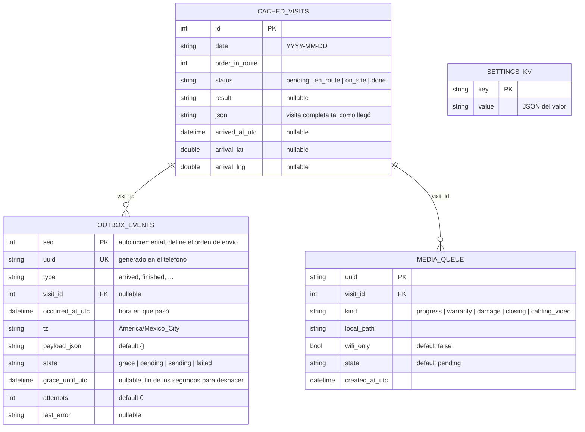

# Telyser · App de campo (Flutter)

**Login, Mi día y tarjeta de visita, con datos de prueba.**

## Cómo arrancar
1. `flutter pub get`
2. `flutter test` (prueba que `assets/mock/my_day.json` cumple el contrato y demas tests)
3. `flutter run`

Usuarios de prueba (cualquier contraseña):
- `pedro` (o cualquier otro): técnico. Pestañas Mi día y Avisos.
- `tono`: técnico + ingeniero + coordina rutas. Pestañas Mi día, Rutas, Por validar y Avisos.

## Estructura
```
lib/
  core/        tema (colores de Figma), hora UTC -> México, widgets (deslizable, etiquetas…)
  domain/      modelos del contrato my-day, enums, estado del técnico (calculado)
  data/        repositories.dart (interfaces) + mock/ (datos de prueba) + providers.dart
  features/    auth · shell (pestañas por permisos) · my_day (lista y tarjeta de visita)
assets/mock/   JSON de ejemplo: my_day, sesión de técnico y de jefe, settings
docs/          contrato_api.md y base_local_drift.dart.txt (para el paso 2)
```

## Base de datos local (Drift / SQLite)

Archivo `telyser.sqlite` dentro del teléfono. Definida en `lib/data/local/app_database.dart`.
Después de cambiar una tabla: `dart run build_runner build --delete-conflicting-outputs`.



| Tabla | Para qué sirve |
|---|---|
| `settings_kv` | Parámetros de `/api/settings` (10 s para deshacer, 150 m, etc.). Sin señal se leen de aquí |
| `cached_visits` | Ruta del día descargada, para verla sin señal |
| `outbox_events` | Cola de acciones por enviar, en orden (`seq`) y con `uuid` para evitar duplicados |
| `media_queue` | Fotos y videos pendientes de subir |

**Estados de `outbox_events.state`:** `grace` (10 s para deshacer, no enviable) → `pending` → `sending` → `failed` (se reintenta). Deshacer borra la fila.

**Nota:** las relaciones por `visit_id` son lógicas. Drift no declara llaves foráneas reales en este esquema, así que la base no impide guardar un `visit_id` que no exista en `cached_visits`.

## Qué falta (siguientes pasos)
2. Salida ("Llevo todo"), Llegué manual, cola local con Drift y 10 s para deshacer.
3. No me abren (espera, llamadas, "No me atendieron").
4. Extras, solicitudes y garantía.
5. Plan y Por validar (ingeniero).
6. Pantalla del jefe de ruta.
7. Llegué automático (geocerca) y notificaciones push.
8. API real y pruebas sin señal.

## Aviso
Si `flutter run` o `flutter analyze` marcan errores, probablemente sean detalles menores
de sintaxis o de versión de paquetes.
